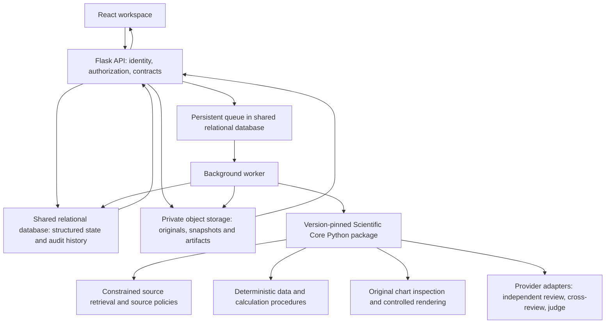

# EvidenceTwin V1: Hosted scientific verification backend

* **Author:** Abdulrahman Ahmed
* **Status:** Draft — Overview, The Problem, Goals and Non-Goals approved on 2026-11-05. Technical Plan incorporates the V1 policy baseline with status **Recommended for owner approval**, as authorized on 2026-11-06. Individual recommendations are not final implementation decisions; all Decision, Enablement and Pilot gates remain OPEN. Production implementation/deployment is not approved.
* **Date:** 2026-11-05
* **Last design update:** 2026-11-06
* **Working-plan review:** Approved for further Technical Design Refinement on 2026-11-06; individual recommended choices and all gates retain their separate approval boundaries.
* **Predecessor:** [Approved V1 concepts brief](concepts_brief.md)
* **Review context:** [Six-lens brainstorming report](docs/designs/backend-completion/2026-11-05-goldfish/goldfish_review_report.md)
* **First acceptance case:** [Ember 2025 electricity share](docs/designs/backend-completion/ember-2025-acceptance/acceptance_case.md)

## Overview

EvidenceTwin V1 will help researchers determine whether a bounded quantitative claim follows from its cited evidence. A browser-based React workspace will connect to a Flask API and one independent Python Scientific Core. The Core will combine source and dataset checks, reproducible numerical procedures, chart inspection and specialized AI review. AI agreement will not establish scientific validity.

The first deployment is a controlled cloud-hosted pilot for researchers, students, research teams, educators and supervisors. Researchers will create accounts, manage cases, submit claims and supporting materials, monitor analyses, inspect findings and export reports without installing software or configuring models. The design will enforce explicit account permissions and reserve shared provider configuration for authorized operators.

The report will explain what the evidence demonstrates, suggests or leaves unresolved. Source authenticity, check coverage, claim support and job completion will remain distinct. When evaluating a historical publication, the primary assessment will use its established publication-time evidence and methodology; a separate current assessment will use a later identified data version. New findings will create linked results rather than overwrite scientific history.

This design extends the existing application. Its current uploads, local records, provider adapters, Council conversations and exploratory reports provide useful foundations, but do not establish a hosted account boundary or an operational scientific verification service. Existing behavior will be preserved where its meaning remains valid; necessary contract and data migrations will be explicit.

## The Problem

A scientific chart or interpretation can appear convincing while relying on the wrong denominator, incompatible populations, undisclosed estimates or a numerical error. A model can also give a plausible answer without reproducing a calculation or inspecting the original source. Multiple models may repeat the same mistake.

Researchers need to see which exact assertion was checked, which source and data version it refers to, what calculations actually ran, what was missing and how each conclusion follows. An authentic source can contain a mistaken conclusion. Missing evidence prevents evaluation; it does not prove a claim false. A technically successful job can still produce an incomplete scientific assessment.

Historical claims introduce a further problem: a publisher can revise its data after publication. Comparing an old report directly with today's download can make a valid historical statement appear wrong, while matching a later file to a printed number does not prove that file existed at publication. The system must preserve the evidence available for each assessment and make revision effects inspectable.

The Ember acceptance case illustrates this boundary. Manual reference arithmetic reproduces the report-associated dataset's figure, while a separately downloaded current dataset yields a different share. Publication-time identity of the report-associated bytes and methodology has not been established, and the original chart has not been inspected. The system must report those limitations instead of forcing an expected 43% result or claiming that every verification step passed. The linked case document contains the reference calculations and preserved evidence; no scientific backend acceptance run is claimed here.

The current local backend cannot meet the hosted pilot's operational requirements by adding sign-in alone. Research records, files, exports, background jobs and provider administration need consistent access boundaries. Long-running work also needs durable state, recoverable failures and bounded resource use without silently repeating uncertain paid model calls.

## Goals

These are requirements for the design and its eventual acceptance tests, not claims of implemented behavior or measured scientific accuracy.

### G01 — Support a bounded, declared scientific scope

Cover the five agreed claim categories: numerical/descriptive, comparative, visualization-based, basic statistical, and methodological/interpretative claims. Define the supported combinations of claim, source, data shape and procedure before exposing them as verified capabilities. A request outside those combinations must receive an explicit limitation or unsupported-method response, not a guessed result.

Accept CSV, multi-sheet XLSX, PNG/JPG and source URLs under declared parsing and evidence policies. Document the treatment of existing exploratory formats. Image-only input may support a limited visual audit, but cannot establish exact numerical or statistical verification.

**Acceptance condition:** every executed or unavailable scientific check identifies its supported procedure, applicability, required inputs and scope. No absent procedure is reported as having run.

### G02 — Bind each assertion to the evidence it actually concerns

Preserve original claims and identify their measurable assertions, definitions, units, geography/population, period, denominator and relevant assumptions. Bind each check to the exact source passage, chart, dataset version, sheet/range or other evidence it uses. Distinguish supplied information from extracted information and unresolved assumptions.

**Acceptance condition:** each major finding can be traced to a specific assertion and evidence reference; an unresolved essential binding is visible and cannot silently become an established fact.

### G03 — Establish source provenance without equating it with scientific truth

Apply explicit source-type policies for identity, authenticity, integrity/version, actual content, dataset provenance, publication notices and source-to-submission correspondence. Preserve check-level results and use the agreed source labels: Verified, Partially Verified, Unverified and Inaccessible.

**Acceptance condition:** a Verified source has passed every applicable mandatory source check. A reachable URL, familiar publisher, matching identifier or file hash alone cannot produce that label. Unavailable notices or inaccessible content remain explicit rather than count as passed checks.

### G04 — Reproduce applicable calculations and examine comparability

Use deterministic procedures for supported numerical and statistical checks, preserving their inputs, units, parameters, assumptions, software/procedure versions and outputs. Check definitions, populations, units, denominators, aggregation and periods before interpreting comparisons. Report statistical uncertainty only when the required information and applicable method support it.

**Acceptance condition:** another researcher can repeat each retained deterministic calculation from its recorded inputs and procedure. Missing sample sizes, incompatible definitions or unsupported tests cannot produce invented p-values, intervals or significance conclusions.

### G05 — Keep visual inspection and AI contributions auditable

Inspect actual original visualizations where supplied and accessible. Compare a Neutral Twin only when its construction, data bindings, assumptions and controlled modifications are recorded. Preserve independent reviewer contributions, cross-review criticisms, actual disagreements, execution failures and evidence-linked judge assessments.

**Acceptance condition:** no visual audit is claimed without access to the inspected artifact; no transformation silently alters the underlying evidence; and reviewer agreement, a completed conversation or an AI-generated judgment cannot by itself establish verification.

### G06 — Distinguish contradiction, incomplete evidence and incomplete execution

Report claim assessments separately from source status, check coverage and execution state. A Contradicted assessment needs traceable conflicting evidence and completed required checks for the disputed assertion. Insufficient Evidence identifies missing inputs and the next evidence needed. A failed tool or provider call must remain distinguishable from a scientifically meaningful insufficiency.

**Acceptance condition:** the hypothetical 20%-versus-reproduced-5% assertion and missing-treatment-data scenario yield distinct explanations and evidence/check records. Mixed-claim reports do not conceal those differences behind one unexplained badge.

### G07 — Preserve time-specific results and explain revisions

Make historical verification primary for a historical report, bound to established publication-time inputs and methodology. Keep a separate current assessment and revision comparison. Preserve the agreed distinctions: Historically Supported, Historically Supported — Later Revised, Historically Contradicted, Historical Verification Incomplete and Current Data Disagrees.

**Acceptance condition:** later data never silently changes an earlier result. Unavailable or unestablished historical inputs yield an incomplete historical assessment. Revision comparisons identify the versions, reported/recomputed values, difference units, relative base, documented cause and interpretation impact; unknown causes and dates remain unknown.

### G08 — Provide usable reports, evidence requests and reproducibility records

Show claim-level coverage, supporting/conflicting/missing evidence, source provenance, calculations, methodological limits, reviewer disagreements, concise explanations and next steps. Preserve originals, permitted source snapshots, data transformations, model/prompt versions, outputs and audit history under an explicit retention/export policy. Supplying new evidence creates an attributable revision, distinct from retrying the same accepted inputs.

**Acceptance condition:** every report identifies its evidence revision and assessment time. Researchers can inspect the retained basis for its major findings and understand what additional evidence could improve the result. Deletion or expired retention must not leave an unconditional promise that unavailable content remains reproducible.

### G09 — Protect hosted cases and provider authority

Enforce account/case permissions for direct reads, collections, totals, files, reports, exports, comparisons, audit records and background work. Keep shared model/credential administration operator-authorized. Explain which evidence is sent to external providers and define private-data handling, retention and deletion before the pilot.

**Acceptance condition:** cross-account negative tests and researcher-versus-operator tests cover every relevant resource class. A normal researcher cannot change global provider credentials or retrieve another account's evidence through an alternate route.

### G10 — Operate within declared pilot limits and migrate existing work safely

Define durable analysis/attempt execution, cancellation, retry and recovery semantics. Bound ingestion, source retrieval, numerical/rendering work, provider usage and spend. Preserve the distinction between measured usage, estimated cost and unknown billing. Separate API liveness, dependency readiness and worker progress, and provide safe actionable errors and correlation references.

Plan account ownership, schema/API, file and worker migration together. Preserve recovery material and avoid silently assigning legacy research records to a new user or converting exploratory outputs into verified results.

**Acceptance condition:** the later verification plan covers interrupted and duplicate work, uncertain paid calls, stale results, cancellation, quota limits, unavailable dependencies, bounded retrieval, ownership migration and rollback. Pilot capacity, budget and timing thresholds remain explicit design decisions, not invented performance claims.

## Non-Goals

- Universal verification of arbitrary scientific statements or every possible source, file layout or statistical method.
- Complex domain-specific causal identification, specialized clinical/experimental validation, predictions or complex meta-analyses as verified V1 capabilities.
- Numerical/statistical verification inferred from chart pixels alone, or arbitrary unstructured-document verification without a specified extraction and matching pipeline.
- Scientific authority inferred from publisher reputation, peer review, HTTPS, agent agreement, neutral-chart labeling or job completion.
- Reconstructing missing historical data from a later rounded match and presenting it as the original dataset.
- Automatic attribution of a revision to corrected errors, new observations or changed methods without documentary evidence.
- Replacing the existing React/Flask stack or duplicating the Scientific Core for each future client.
- Requiring researchers to install local software or provide/configure their own AI models.
- MCP, assistant Skills, an external developer platform or institutional deployment features as prerequisites for the first browser pilot. They remain future interfaces to the same Core.
- Unapproved team-sharing permissions, cloud vendors, authentication products, persistence products, queue technology, statistical allowlists or budget defaults. These require decisions in later design sections.

## Technical Plan (Architecture)

This section describes the proposed mechanisms needed to satisfy the approved goals. It is not an implementation instruction or a claim that these services exist. The architecture decisions below must be resolved with the author before this section receives final approval. A database-backed queue is selected at the architecture level; no deployment product, database engine, queue implementation, authentication provider or statistical procedure has been selected.

**Incorporated policy baseline — Recommended for owner approval.** On 2026-11-06 the owner authorized incorporation of the [Q01–Q60 package](docs/designs/backend-completion/RECOMMENDED_DECISIONS.md) as the recommended V1 policy direction. That authorization does not finalize its individual recommendations or close any gate. Earlier explicitly approved decisions remain approved; the proposed specifications, products and mechanisms below retain their stated approval boundaries. PostgreSQL remains a candidate. The [gate register](docs/designs/backend-completion/TECHNICAL_PLAN_GATES.md) is part of this plan: all Decision, Enablement and Pilot gates are OPEN. No scientific capability is enabled while mandatory specifications or acceptance remain unresolved.

### 1. Responsibilities and data flow

Keep React as the researcher interface and Flask as the authenticated API. Keep the Scientific Core independent of Flask request objects, browser schemas and storage products. A background worker executes long-running work; a web request accepts or rejects work without waiting for the Council to finish. The author selected T01 option A: workers import a version-pinned, framework-independent Python Core package. Flask schedules work and reads results; it does not execute long-running Council work inside an HTTP request.

These are responsibility boundaries, not one deployable service per box. There is no separate Core HTTP service in the selected V1 design. Web and worker execution remain separate; sharing a package does not mean running scientific work in the web process. Package/runtime releases must be coordinated and every attempt must retain its exact Core version. The author selected a shared relational database and private object storage; API and worker processes may initially run on the same host and access the same logical stores through explicit interfaces. Separate hosts are not a pilot requirement. Retrieval isolation, dispatch technology, concrete storage products and backup mechanisms remain author decisions. Future MCP access must enter through equivalent authorization and reuse the same Core package; it is outside the V1 release path.

Flask owns actor permissions, input acceptance, quotas, safe resource access and response projection. The Core owns scientific procedure execution and structured scientific results. Workers own dispatch leases and attempt execution. Storage adapters own persistence mechanics. The Core receives explicit immutable evidence references and a scoped execution context; it cannot obtain unrestricted application records by importing Flask globals.

### 2. Research identities and immutable evidence

The design needs distinct identities for private research cases, educational examples, evidence revisions, execution attempts and report versions. The shared relational database owns structured application state: accounts, research cases, evidence metadata, execution state, verification records, verdicts and audit history. Private object storage holds original uploads, datasets, source snapshots, generated artifacts and report objects. Structured report/assessment records and the corresponding report objects must reference the same immutable report version; rendered artifacts must not become an independent conflicting source of verdicts. Exact table structure, column/document choices and physical layout remain open. Proposed conceptual records are:

| Record | Meaning and retained references |
| --- | --- |
| Research case | Authorized ownership/access boundary, original research question and linked evidence revisions. This is different from an educational library case. |
| Evidence revision | Immutable submitted claims, metadata, original artifact references and source bindings. Adding or correcting evidence creates a new revision. |
| Source snapshot | Original/canonical URL, retrieval time, bytes/hash, claimed publication/version identity, official-record evidence, notices and check results. Retrieval time is not publication time. |
| Parsed dataset | Original artifact, parser/version/settings, sheet/range, row/cell lineage, variables, units, missing-value handling and transformations. |
| Check result | Procedure/policy version, assertion and evidence references, applicability, exact input scope, parameters, outputs and limitations. |
| Execution attempt | Evidence revision and configuration snapshot, stage state, execution ownership, external-call records, usage and failures. |
| Reviewer contribution | Reviewer role, model/provider and prompt versions, supplied evidence scope, cited findings and actual isolation/cross-review phase. |
| Assessment/report version | Claim-level results, coverage, historical/current bindings, limitations and reproducibility manifest; linked to the producing attempt. |

References must identify the revision being used. A retry of the same evidence creates another attempt, not a new scientific input. A new source snapshot or revised dataset creates a new evidence revision and linked assessment. Previous reports remain addressable, subject to the eventual retention/deletion policy. Immutability prohibits silent editing; it does not promise perpetual storage or defeat authorized deletion.

Every stored evidence object must have a stable identifier, cryptographic hash, ownership metadata and version-aware references recorded in the database and associated with the stored object. Original evidence must never be silently overwritten. Dataset revisions and updated source snapshots create new immutable evidence records and object references; a mutable filename or a storage provider's latest-version alias is not a scientific evidence identity. Hash algorithm, key layout and use of provider version IDs remain implementation decisions; a hash alone does not establish source authenticity.

Database commits and object writes are not assumed to form one atomic transaction. The detailed design must define object acceptance/publication states and reconcile incomplete writes, missing objects and unreferenced objects without publishing a report that depends on unavailable evidence. Storage-provider versioning is not a substitute for application-level revision records.

Coordinate database backups with object-storage retention/versioning. Document a restoration procedure that can recover a mutually consistent set of structured records and referenced object versions, including ownership, hashes and report/attempt links. Test recovery and verify reference resolution, object integrity and permissions before accepting restored data as usable. Backup mechanism, retention periods, recovery targets and reconciliation details remain open; no successful recovery test is claimed by this document.

### 3. Separate execution, evidence coverage and scientific decisions

Do not overload the existing `mode`, job `status` or overview `assessment` fields with the entire verification record. Selecting Verified Mode expresses a requested workflow, not an achieved result. Job completion expresses execution state, not scientific support.

Keep execution state, source verification, per-check progress, per-claim support and historical/current assessment separate. The author's T06a/T06d refinements separate claim coverage, report verification and conclusion:

| Field | Approved values | Meaning |
| --- | --- | --- |
| `claim_coverage_status` | `complete`, `partial`, `incomplete` | Completion of the material claims' mandatory verification requirements, independent of report-level gates and claim truth. |
| `report_verification_status` | `complete`, `partial`, `incomplete` | Overall verification completeness subject to mandatory report-level gates; never an endorsement of claim truth. |
| `overall_conclusion` | `supported`, `mixed`, `contradicted`, `inconclusive` | The evidence-based report conclusion, derived under an explicitly approved aggregation policy. |

Report-level **Verified** denotes `report_verification_status=complete`: all mandatory verification requirements are satisfied, every in-scope claim has an evidence-based assessment, required calculations/validation are completed, and findings, limitations and disagreements are documented. No mandatory verification step may remain incomplete. Supported and Contradicted claim outcomes do not by themselves prevent complete verification. **Partially Supported is proposed and unresolved**, as clarified by the owner on 2026-11-06; its meaning, eligibility and aggregation must be explicitly reviewed before it is an approved claim outcome. Insufficient Evidence and Unresolved remain distinct claim outcomes; if a mandatory verification requirement cannot be completed, the report cannot receive unconditional Verified status. The earlier proposed combined name `verification_status` is refined into the explicit claim/report fields above; it is not a third, independently mutable completeness value. Public compatibility mappings remain to be specified, not silently inferred.

Show claim coverage, report verification and conclusion together so completeness cannot be mistaken for endorsement. A completed job is not completed verification, and completed verification is not proof that the claims are true. Source-level Verified retains its separate authenticity/provenance meaning. Historical/current assessments and their evidence bindings remain separate from these fields. T06b defines evidence-based conclusion aggregation; T06c/T06d define claim coverage and report gating below. Legacy mappings remain open. No majority-vote or frontend-derived verdict is permitted.

**Approved verification-completeness policy (T06c):** identify material claims before final aggregation and assign each claim an explicit set of mandatory verification requirements. Measure completeness by material scientific content evaluated, not by the number of technical checks executed.

| `claim_coverage_status` | Author-approved rule |
| --- | --- |
| `complete` | Every in-scope material claim satisfies all its mandatory verification requirements. This claim-level field remains complete even if a report gate fails. |
| `partial` | At least one material claim satisfies all its mandatory verification requirements, but one or more other in-scope material claims remain incompletely verified. |
| `incomplete` | No material claim satisfies all its mandatory verification requirements. |

A fully evaluated claim can count as complete whether Supported or Contradicted. Partially Supported remains a proposed, unresolved verdict, not an approved completeness/aggregation branch. Keep individual check progress, missing evidence, unresolved disagreements and unavailable checks separately visible. A missing required check does not become satisfied merely because its absence was documented. A submission with no identified material claim requires explicit input/policy handling rather than vacuous completeness.

**Approved mandatory report gate (T06d):** any failed or unavailable mandatory report-level requirement forces `report_verification_status=incomplete`. Preserve `claim_coverage_status=complete` when all material claims are individually complete; preserve their assessments, calculations and evidence references. When all mandatory report-level requirements are satisfied, the report's completeness follows the material-claim coverage rule. An unmet mandatory gate never produces unconditional Verified status.

Record each mandatory blocker explicitly with the check identity, whether it executed and failed or could not be performed, the available result/reason and its effect on report verification. Do not collapse these causes into one generic failure or reinterpret either as a scientific contradiction. Report processing state, check progress and the last successfully published report version remain separately inspectable. Exact check-state enums and report gate definitions still require the scientific support matrix.

**Approved classification authority (T06e):** the system may propose AI-assisted claim roles and materiality, but the researcher reviews, overrides where needed and confirms them. AI proposals never silently become approved scope. Use the confirmed classification associated with the immutable analysis snapshot for aggregation.

| Confirmed role | Meaning |
| --- | --- |
| Primary | Central assertion being investigated. |
| Supporting | Assertion contributing to or substantiating a primary claim. |
| Contextual | Background assertion providing context without independently determining the overall conclusion. |

Materiality is recorded separately from role; a role value is not a substitute for a materiality decision. For every claim preserve proposed role/materiality, proposed rationale, researcher-confirmed role/materiality, confirmation identity/timestamp and classification revision history. Researchers may override proposals. Changes to confirmed classifications create a new recorded revision; they do not rewrite the classification used by an existing report.

Researcher confirmation is required before execution of the confirmed analysis scope. Independent claim assessments may still be performed and displayed before confirmation, as explicitly permitted by the author, but they do not authorize final report aggregation. Unconfirmed roles or materiality are explicit aggregation blockers. Treat AI-assisted classification itself as a preparatory operation, not researcher confirmation; its LLM requests remain subject to shared provider limits and accounting. The detailed pre-execution interaction and job/assessment contracts must preserve this distinction.

**Approved conclusion policy (T06b):** distinguish primary, supporting and contextual claims using the confirmed classifications before final aggregation. Identify the material findings and explain which of them determine the conclusion. Preserve every individual verdict, missing-evidence record and unresolved disagreement. Do not turn an unresolved disagreement into a definite finding merely to obtain a report label.

| `overall_conclusion` | Author-approved rule |
| --- | --- |
| `supported` | Material in-scope claims are supported, with no material contradiction affecting the overall conclusion. |
| `contradicted` | Material in-scope claims are contradicted, with no material supporting findings that change the overall interpretation. |
| `mixed` | Material findings have genuinely different outcomes, or definite findings coexist with unresolved claims that do not prevent a meaningful overall assessment. |
| `inconclusive` | No material claim can be adequately assessed, or the primary claim remains unresolved in a way that prevents a defensible overall conclusion. |

Definite findings are not discarded simply because other claims lack evidence. Conversely, a definite supporting or contextual finding cannot justify a meaningful overall conclusion when the unresolved primary claim prevents one. Apply these rules to the confirmed assessment scope, keeping historical and current layers distinct. The Evidence Judge must cite the determining claims and evidence, explain remaining uncertainty and use the rules rather than a simple majority vote or count of agent assessments. Detailed proposal criteria, confirmation/revision contracts and policy validation still need operational definitions; do not silently substitute claim counts or numeric voting weights for them.

For each claim retain completed and unavailable checks, supporting and contradicting references, missing evidence, concise evidence-based reasoning, limitations and next steps. Contradicted requires reliable conflicting evidence and the applicable completed checks. Failed tools and inaccessible sources are recorded as failures/limitations, never as evidence against the claim. An incomplete report can be produced without asserting that verification succeeded.

Check records must distinguish an observed mismatch from inability to run the check. The precise canonical enums and their legacy mappings will be approved with T05/T06 before implementation. A legacy `unsupported` label must not silently become `contradicted`, and source `unavailable`/`unknown` must not silently become `inaccessible` without an actual retrieval result.

### 4. Version-aware scientific pipeline

1. **Accept inputs and define assertions.** Preserve the user's wording. Identify scope, variables, units, period, population, denominator and precision. Record whether information is supplied, extracted or unconfirmed. Propose roles/materiality separately and retain rationale; researcher confirmation establishes the analysis classification snapshot. Unconfirmed classification blocks final report aggregation even if independent claim assessments exist. Essential ambiguity blocks the affected check and prompts a researcher correction rather than an invented assumption.
2. **Retrieve sources under a declared policy.** Preserve content and retrieval metadata. Evaluate official identity, original versus secondary status, integrity/version, actual relevant content, dataset lineage, publication notices and submission correspondence. A source-type policy identifies mandatory checks and acceptable evidence for each. Unsupported identity/content checks remain unavailable. No reachable URL alone passes authenticity.
3. **Parse and bind data.** Preserve original bytes and a bounded lossless interpretation where supported. For XLSX, automatically inventory worksheets and independently inspect eligible sheets within configured limits; preserve names/ranges and explain every exclusion. Keep worksheets as separate evidence units. Researchers can exclude irrelevant sheets and select ranges before final analysis. Matching headers or apparent similarities never justify automatic merging; methodological justification and explicit researcher confirmation are required for combining datasets. Record encoding, locale/number rules, formulas versus cached values, missing data and transformations. Do not execute workbook macros or external links. Formula/encoding handling and exact resource limits require T07 before enabling XLSX verification. Never silently truncate a dataset and describe the subset as the complete evidence.
4. **Establish temporal bindings.** For historical evaluation require documented publication-time dataset and methodology identity. Store current evidence independently. Missing historical evidence yields Historical Verification Incomplete even if a later file matches the printed number. Keep revision dates/causes unknown when documentary support is absent.
5. **Run applicable deterministic procedures.** Resolve an approved procedure from the support matrix; record inputs, versions, units and numerical precision. Test comparability before interpreting differences. Statistical checks require their specified data and methodological prerequisites. Procedure failures, missing prerequisites and substantive contradictions are distinct results.
6. **Inspect the actual chart.** Bind chart values, labels, encoding and axes to the selected dataset when the correspondence can be established. A Neutral Twin requires recorded rendering choices and controlled modifications; inability to inspect the original or establish its data is explicit. The exact blind-review/rendering protocol requires T07.
7. **Run specialized reviews.** Retain the Visual Analyst, Statistical Auditor, Scientific Skeptic and Counterfactual Analyst roles. Independent initial contributions receive no other reviewer outputs. Record shared models and evidence scope; conversation isolation does not establish independent scientific confirmation. Cross-review consumes only valid, traceable contributions and retains failed or missing roles. The partial-review completion rule requires T06 rather than silently relaxing the existing four-review prerequisite.
8. **Assess and publish.** Combine check results and evidence-linked reviewer contributions under an approved assessment policy. An LLM judge cannot promote unsupported assertions into verified facts. Validate evidence references and policy prerequisites before publishing a versioned report. Keep historical and current results separate and link any revision comparison.

The support matrix must define a concrete procedure, required inputs, source policy, limits and reference examples for each enabled combination. The five categories are the V1 scope, not a promise that every method within them is available. Source retrieval, statistics, Neutral Twin and other capabilities remain unavailable until their policy and acceptance checks are implemented.

### 5. Durable execution, cancellation and external calls

**Approved dispatch boundary (T04):** use a persistent database-backed queue in the same relational database as the application. Submission atomically creates the analysis job, execution attempt and pending queue entry in a single database transaction. Queue records reference immutable evidence and analysis inputs; large file contents stay in private object storage. Workers execute independently of Flask request lifetimes. No separate message broker is required for the initial pilot.

Workers claim jobs through atomic database operations, preventing simultaneous valid ownership. Time-limited leases and periodic heartbeats support recovery of abandoned work after worker failure. Ownership checks and fenced result writes must reject stale workers after reassignment. Do not hold database transactions open while retrieving sources, performing long scientific operations or calling LLM providers: use short claim/checkpoint/heartbeat/result transactions around that work.

Provide bounded retries with backoff, explicit terminal failure states and auditable execution history. Retry only steps whose replay is safe under the recorded procedure and external-call state; recovering an abandoned job does not authorize blindly repeating an uncertain paid LLM call. Make supported step effects idempotent and prevent duplicate result publication. Idempotent application writes do not establish exactly-once execution at an external provider. Retry limits, delay policy and safe replay classifications remain to be specified before implementation.

Support cancellation of pending and running jobs, configurable polling intervals and the approved shared concurrency limits. Persist state transitions, claim/recovery events and retry/cancellation history with job and attempt correlation. The selected database engine and queue implementation must demonstrate safe concurrent claiming across worker processes. The existing local SQLite implementation is not presumed suitable for this hosted requirement without explicit validation. A broker may be reconsidered through a design change if measured throughput, contention or independent scaling needs justify the additional infrastructure.

**Approved pilot concurrency assumption:** target at most **2 simultaneously executing analyses**, with an operator-configurable analysis limit rather than a hardcoded value. Additional accepted submissions remain in a persistent job queue until execution capacity is available. The limit applies across the deployment, not separately to each worker process; adding workers must not multiply it. A full execution pool is a queued state, not a failed scientific analysis. Queue admission limits and overload responses remain to be defined; persistence does not mean unlimited queue capacity.

**Approved LLM concurrency assumptions:** allow at most **1 in-flight LLM request per analysis** and **2 in-flight LLM requests globally across the initial pilot**. Reviewer requests execute sequentially within each analysis. The global provider-level limit is shared across workers and analyses; it is not a separate allowance of 2 for every worker, API key or provider adapter. Both limits are configurable. Cross-review, judging and other LLM calls must use the same controls rather than bypass them; their input dependencies still apply regardless of available capacity.

Acquire permission under both the per-analysis and global bounds before dispatching an LLM request. Shared concurrency controls must enforce these bounds across execution processes; process-local semaphores alone are insufficient. Their concrete storage/coordination mechanism depends on T02/T04. Configuration reductions must prevent new dispatches above the new bound without pretending to revoke already-dispatched calls. Provider request/token rate limits and budgets remain additional controls: a concurrency cap does not itself bound tokens per minute or total spend. Cancellation, lease expiry and uncertain in-flight calls must be reconciled before replacement work can be treated as safely within those limits; reservation lifetime, fairness and recovery rules remain to be decided.

The analysis and LLM concurrency targets are infrastructure planning assumptions, not measured capacity or performance guarantees. Raise concurrency only after representative load testing and monitoring of execution time, provider capacity and limits, latency, memory consumption, failure rates and operating costs. Record the tested configuration and workload with results. Changing configuration alone does not validate a higher capacity.

Workers claim an attempt with bounded ownership, renew ownership while progressing and fence writes with the current attempt/lease identity. Duplicate delivery and delayed results must not create duplicate published steps or overwrite cancellation, a newer evidence revision or a later attempt. Checkpoints bind all reused outputs to their inputs, policy/model/prompt versions and reuse eligibility. Safe local computations may be repeatable; external model requests have different recovery rules.

Before sending a paid request, retain its dispatch intent and a bounded usage reservation. After receiving and validating a response, record its result and actual usage where provided. A crash after dispatch but before durable response storage leaves an uncertain external outcome. Recovery must not blindly resend it. The selected recovery policy must expose uncertainty and require an authorized retry decision or documented provider reconciliation. No exactly-once provider execution is promised.

Cancellation stops undispatched work and prevents late outputs from being published as active results; it cannot revoke an already-sent provider request. Count or reserve failed, cancelled, uncertain and late-call usage under the eventual budget policy. Provider/model configuration is pinned per accepted attempt; operator edits affect later attempts. Queue implementation, lease/heartbeat/polling intervals and replay policy remain open under T04 and T09.

### 6. Hosted access, retrieval and private processing

An authenticated actor must be authorized for every case, attempt, source, file, report, list/count, comparison, export and linked resource. Workers must execute only the accepted case scope and stop publication if that scope is revoked/deleted. Guess-resistant IDs do not replace authorization. A comparison must authorize both records independently. Operator diagnostics and shared provider settings require separate permissions from researcher access. Team/supervisor sharing is unresolved, not implicitly enabled.

**Approved authentication boundary (T03):** delegate user authentication and credential recovery to an external identity provider through a replaceable adapter. Validate identity tokens on the backend; browser-reported identity is not sufficient. Map the provider's validated issuer and stable subject identifier to an independent EvidenceTwin internal user ID. Email alone cannot establish an account mapping or justify automatically linking two identities.

EvidenceTwin owns application-level account state, roles, authorization policies, research permissions and case ownership. External identity establishes who authenticated; provider-specific role claims or APIs must not become the authority for application authorization. Provider changes must preserve internal user IDs and research ownership through an explicitly approved migration rather than reconstruct ownership from email addresses. API and worker authorization continues to use EvidenceTwin's internal identities and scoped permissions.

Registration is invitation-controlled for the pilot. Successful external authentication alone does not grant registration or research access. Before implementation, define invitation issuance/redemption, account linking and unlinking, provider migration, suspension, deletion and treatment of active sessions/jobs. These lifecycle mechanisms remain open; selecting external authentication does not select their policies. Keep provider selection and configuration as explicit deployment decisions, not hardcoded dependencies in authorization or research repositories.

The adapter contract must specify validated identity output and safe failure handling; provider-specific token validation details, session expiry/revocation and recovery integration remain to be designed after provider/protocol comparison. Cookie-backed mutations require a defined CSRF boundary; cross-origin authenticated requests require explicit origins and credential configuration. Existing CORS `supports_credentials=False`, same-origin frontend requests and the optional auth hook are integration foundations, not a complete account system. The deployment design must decide origins and session transport together.

Source retrieval must limit schemes, destinations, redirects, DNS resolution, response size, decompression, content types and time. Block internal, loopback, link-local and infrastructure-metadata destinations at connection time as well as initial URL validation. Reapply destination checks after redirects. Do not forward application cookies, provider credentials or user authorization to arbitrary source URLs. Source content is untrusted input, including instructions embedded in documents. The selected isolation mechanism must be tested against DNS changes and parser/network abuse; public reachability alone does not solve this boundary.

Private artifacts require scoped access on every read; public global hash lookup or cross-account deduplication must not leak evidence existence. Provider processing disclosure and authorization, retention, permitted source snapshots, credential storage/rotation, backup expiry and deletion propagation remain explicit decisions under T08. Do not promise reproducibility after underlying artifacts have been deleted; retain only the audit information permitted by that policy and disclose any remaining reproducibility limit.

### 7. API and frontend integration changes

Preserve existing analysis/inspection/report navigation, identity validation and capability-aware unavailable states. Keep all scientific decisions on the backend. React must validate the requested record identity before loading related sections or offering actions. Existing browser comparison preselection uses `a`/`b`; the API comparison uses `analysisA`/`analysisB`. That deliberate transport distinction is preserved.

Existing contracts are strict in Python and enum-constrained in TypeScript. Necessary changes include per-claim coverage/evidence bindings, distinct source Inaccessible status, temporal assessments, immutable evidence/attempt/report references, missing-evidence revision handling, safe structured errors, authorization context and procedure-level capabilities. Do not send new enum values to an old client or rely on old schemas stripping unknown fields to make scientific information visible. T05 selects explicit URL-based API versioning; endpoint schemas and compatibility mappings remain to be finalized.

**Approved API version boundary (T05):** expose all new public API contracts under `/api/v1/`. Define explicit endpoint request/response schemas and consistent validation/serialization within that version. Public contracts are deliberate projections, not direct serialization of internal Python models. API versioning is independent of Core schema, agent prompt and evidence snapshot versions; record those versions separately for reproducibility without treating a prompt or snapshot update as an automatic API version change.

Maintain existing frontend contracts only during a defined, time-limited migration. Compatibility adapters translate old wire shapes to/from the same application and scientific services; they must not duplicate business or scientific logic. Document every deprecated route and its replacement, supported behavior, transition deadline and removal conditions. Define the deprecation/removal policy before introducing breaking changes. Future incompatible public contracts may use `/api/v2/` with a supported transition period. No exact migration duration, immediate cutover or indefinite legacy support is authorized by this decision.

Keep existing list pagination contracts where possible; execute authorized filtering, sorting and counts in storage with suitable indexes rather than `Store.all()` followed by in-memory filtering. Dataset inspection needs bounded, stable paging of the selected revision. Report list and full report must identify the same assessment version. JSON/print/export views must retain evidence references and limits; redaction is not a substitute for authorization.

Reuse bounded visible-page polling unless a later approved requirement needs streaming. Query/cache identity must include the relevant actor, record and revision; clear private caches on account changes. Loading, expired-session, forbidden, incompatible-contract, unavailable-service and empty-data states remain distinct. New evidence/coverage displays must preserve English/Arabic, RTL, keyboard access, focus restoration, reduced motion and screen-reader announcements. No redesign is proposed.

Capabilities must distinguish implementation support, provider configuration, actor permission, queue readiness and evidence eligibility. A configured provider does not make a statistical procedure operational. Public health can report API liveness; protected readiness/diagnostics report dependencies and worker progress without secrets or private research content.

### 8. Changes to existing components and proposed new boundaries

These are inspected touchpoints and proposed responsibilities, not the exhaustive file-by-file implementation plan, which follows only after architecture approval.

| Current location or proposed boundary | Planned responsibility |
| --- | --- |
| `backend/evidencetwin_backend/__init__.py`, `config.py`, `blueprints/` and proposed authentication adapter | Preserve the factory/Blueprint structure; validate external identity on the backend, map issuer/subject to internal users and enforce invitation/account state. Keep EvidenceTwin authorization separate from provider-specific identity handling; add request contracts and safe infrastructure errors. |
| `backend/evidencetwin_backend/services/runtime.py` | Separate HTTP acceptance/projection from scientific execution and storage operations; add explicit revision/attempt handling through the chosen contract. |
| `backend/evidencetwin_backend/services/store.py` and proposed object-storage interface | Replace unrestricted single-workspace access with scoped relational repositories, transactional execution acceptance and indexed pagination; use explicit private object operations with immutable references. Database/object products, physical schema and restoration mechanism remain open under T02. |
| `backend/evidencetwin_backend/services/workflow.py` and proposed queue/worker boundary | Replace the in-process executor with a persistent database-backed queue, atomic job/attempt acceptance, atomic claims, leases/heartbeats, bounded safe retries and independent workers; preserve stale-result and cancellation protections without long-running database transactions. |
| Independent Core Python package (selected in T01) | Versioned assertions, evidence bindings, source policies, parsers, procedures, visualization protocol, assessment rules and reproducibility manifests. Workers import the package; exact module/file layout follows scientific policy decisions. |
| `backend/evidencetwin_backend/services/provider.py`, `transports.py`, `ai_settings.py`, `prompts/` | Preserve adapters and owner prompts; introduce versioned policy-approved changes only, scoped operator administration and auditable call accounting. |
| `backend/evidencetwin_backend/contracts/`, `export_contracts.py` | Canonical-to-wire projections and explicit supported schema versions; export and check compatible schemas. |
| `frontend/src/api.ts`, `workspace-api.ts`, `research-api.ts`, `features/research/api.ts` | Version-aware validation, safe API errors, private query lifecycle and new structured scientific fields. |
| `frontend/src/AnalysisWorkspace.tsx`, `features/inspection/`, settings/provider consumers | Display coverage, claim distinctions, temporal layers, revisions and permission limits in the existing layouts. |
| Backend/frontend tests and integration documentation | Add scientific reference tests, tenant/worker failure tests, wire compatibility and browser journeys; document actual capability readiness. |

Under the incorporated baseline (**Recommended for owner approval**), the following additions refine these responsibilities without authorizing source changes:

| Proposed boundary | Contract/responsibility to specify | Required gates |
| --- | --- | --- |
| Scientific policy/procedure registry in the Core | Versioned applicability, method prerequisites, rounding/tolerances, source-family checks and eligibility predicates; canonical scientific results independent of browser DTOs. | D07; E01, E02, E05. |
| Isolated retrieval worker/network | Bounded public-source retrieval with no private-infrastructure/credential access; exact retained snapshots and official-record matching. Parser/content access must obey the same isolation and artifact permissions. | D03, D07; E02; P04. |
| Discovery/confirmation layer | XLSX inventories, formula metadata, parsing ambiguities, claim roles/materiality and evidence bindings; separate proposed and confirmed revisions; block unconfirmed aggregation. | D09; E03, E05, E07. |
| Provider execution adapter and shared controls | Pinned operator per-role assignments; minimized packets; shared leases/permits/rates/budget reservations, explicit processing authorization, uncertain dispatch and settlement history. | D03, D05, D06; E06; P02, P03. |
| Relational repositories/object interface | Scoped records, exact object/version references, transactional queue and approved data schema; object acceptance/reconciliation, deletion and coordinated restoration. | D01–D03, D06; P05. |
| Public DTO/compatibility projections | Explicit `/api/v1/` shapes and safe errors, stable cursor behavior where proposed, legacy page-based adapters with no duplicated science. | D01, D08; E07; P08. |

### 9. Acceptance and migration mechanisms

Before pilot cutover, inventory and back up the local database, original files and report relationships. Establish legacy ownership explicitly; unassigned records stay quarantined. Import exploratory outputs with their original limitations, not as verified results. Reconcile IDs, artifact hashes, counts, references and permissions before enabling writes. Never run the old local executor and new worker as owners of the same active attempts.

A rollback must cover schema, files, dispatch state and new work accepted after cutover. Keep a documented reconciliation path or pause new work when the old version cannot represent it. Restoring an old database alone is not a safe rollback of externally dispatched calls. Exact rollout/rollback steps depend on T02/T04/T05/T08 and will be enumerated later.

Acceptance must include: independently reproducible numerical results; genuine source-check failure and missing-evidence cases; mixed claim outcomes; incompatible denominators/populations; bounded CSV/XLSX parsing; image-only limits; historical/current divergence; reviewer failure/disagreement; cross-account denial for every resource class; duplicate dispatch, interrupted/uncertain paid calls, cancellation and stale writes; account-switch cache clearing; and migration/rollback reconciliation. No arbitrary accuracy target or benchmark success percentage is introduced.

The Ember case remains a reference case with known gaps. Publication-time dataset/methodology identity and original-chart inspection must be established before those stages can pass. Reference arithmetic is not an end-to-end backend test. Add other policy-reviewed cases for supported statistics, XLSX, contradictions and insufficiency rather than treating one ratio as validation of all five categories. Benchmark scoring stays unavailable until its rubric is defined.

### 10. Author decision register

T01 option A, T02 option A at the architecture level, T03 option A for external authentication with internal authorization, T04 option A for database-backed dispatch, T05 option A for URL-based API versioning, T06a option A for verification completeness, T06b option B with the author's materiality/primary-claim rules, T06c option B for material-claim completeness, T06d option B for report-gate failure with separate claim coverage, and the concurrency limits in T09 have been selected by the author. Storage/identity products, queue implementation, backup mechanisms, account lifecycle policies and legacy migration duration remain open. The author requested batch discussion and supplied Q01–Q60 recommendations; their incorporation is authorized with status Recommended for owner approval. This does not replace individual final approvals. A final Technical Plan approval follows sufficient resolution of its design gates; approval of one part does not approve remaining choices.

Subsequent author selections: T06e A, researcher-confirmed roles/materiality with revision history; T07a B, automatic eligible-sheet discovery with independent evidence units and researcher control before final analysis. These decisions do not select an XLSX parser, formula policy or resource thresholds.

For each unresolved T02–T09 detail, section 11 now records the incorporated recommended direction, the full Q package preserves its requirements and section 12 links the OPEN gates. Prior alternative tables are decision history. They do not override subsequent explicit choices or turn recommendations into final approvals.

**T01 — Scientific Core execution boundary (first decision).** Both options preserve separate web and background execution and one scientific implementation.

**Author decision (2026-11-05): A — Shared Python package.** The author answered "A" to the two-option boundary gate. Use one framework-independent Core package, version-pinned with API/worker releases and executed by background workers. A separately deployed Core service is not part of V1; reconsider only through an explicit design change if isolation, dependency or release requirements demand it. This decision does not select storage, dispatch or deployment products.

| Option | Mechanism | Tradeoffs | Fails when |
| --- | --- | --- | --- |
| A — Shared Python package in API/worker deployment | A framework-independent Core package is version-pinned with the application; workers import and execute it. Flask schedules work and reads results. | Fewer network contracts; package/runtime releases must be coordinated. Resource isolation still needs worker/process controls. | Web/worker dependency or release coupling prevents required isolation, or a stable independently operated remote Core is needed. |
| B — Separately deployed Core service | An authenticated internal service executes a versioned Core request; the application worker tracks requests/results and scoped artifact access. | Independent runtime/release ownership; adds service authentication, transport/version compatibility, request reconciliation and operational work. | The team cannot operate/reconcile the extra service, or timeouts/duplicate submissions lack durable identities and ownership. |

**T02 — Persistence and artifact layout (architecture resolved; products and recovery details open).**

**Author decision (2026-11-05): A — Shared relational database and private object storage.** The database owns accounts, cases, evidence metadata, job state, verification records, verdicts and audit history. Object storage holds originals, datasets, source snapshots, generated artifacts and reports. Evidence objects have stable identifiers, cryptographic hashes, ownership metadata and version-aware references. Original evidence is not silently overwritten; dataset/source revisions create new immutable evidence records. API and workers use explicit interfaces to the same logical stores and may initially share a host. Coordinate database backups and object retention/versioning, document restoration and test recovery. Cloud vendors, database products, object-storage providers and backup mechanisms require comparison and author approval.

The unselected single-host database/private-volume alternative reduces services but couples artifact capacity and recovery to a host. The selected shared-database/object-store boundary adds write and backup reconciliation; it fails without scoped object access, version-bound references and coordinated recovery. Choosing this boundary does not require separate API/worker hosts or imply that object storage is already configured.

**T03 — Accounts (architecture resolved; provider and lifecycle details open).**

**Author decision (2026-11-05): A — External identity provider.** Delegate authentication and credential recovery while retaining internal user IDs, application account state, authorization, research permissions and case ownership in EvidenceTwin. Validate identity tokens on the backend and map identities by provider issuer plus stable subject, never email alone. Support invitation-controlled pilot registration. Use a replaceable authentication adapter and keep application authorization independent of provider-specific claims/APIs. Define account linking, identity-provider migration, suspension and deletion explicitly. No identity provider or configuration has been selected.

The unselected application-managed credentials alternative gives direct control but requires maintaining credential protection, recovery and abuse controls. External authentication reduces that credential lifecycle code but adds provider availability and validated identity-mapping responsibilities; it fails if provider identity is mistaken for application authorization or account lifecycle changes do not propagate to access controls. Team/supervisor sharing, operator grants, invitation policy, linking/migration safeguards, session transport/revocation and suspended/deleted-account job behavior still need author-approved rules.

**T04 — Dispatch (architecture resolved; database engine and queue implementation open).**

**Author decision (2026-11-05): A — Database-backed queue.** Use the shared relational database. Atomically create the analysis job, execution attempt and pending queue entry within one transaction. Workers claim jobs atomically and execute independently of Flask requests. Provide time-limited leases, periodic heartbeats, abandoned-job recovery, bounded retries/backoff, explicit terminal failures, idempotent effects and duplicate-result protection, pending/running cancellation, configurable polling/concurrency and auditable execution transitions. Do not hold database transactions open during long-running scientific or LLM work. Queue records reference immutable inputs, not large file contents.

The engine must support safe concurrent claiming across worker processes; the current local SQLite foundation requires explicit validation rather than presumed suitability. No engine or queue implementation is selected. Lease/heartbeat timing, retry classifications/bounds/backoff, cancellation races, shared concurrency reservation mechanics and uncertain external-call reconciliation remain open. Recovery and bounded retries must preserve the existing prohibition on blind replay of uncertain paid requests.

The unselected broker/outbox alternative separates delivery infrastructure but adds another service and transactional dispatch reconciliation. Database-backed dispatch keeps acceptance and jobs together but fails if claim contention, polling load or recovery semantics exceed the selected engine/design. Reconsider a broker only if measured throughput, contention or independent scaling requirements justify it; no broker is required for the initial pilot.

**T05 — Wire migration (strategy resolved; detailed schemas and transition policy open).**

**Author decision (2026-11-05): A — URL-based API versioning.** All new contracts use `/api/v1/`, with explicit request/response schemas, consistent validation/serialization and public contracts separated from internal Python models. Preserve existing frontend compatibility through a clearly defined, time-limited migration. Use compatibility adapters rather than duplicate business/scientific logic. Document deprecated routes and replacements; define deprecation/removal policy before breaking changes. Future incompatible versions may use `/api/v2/` while prior versions remain available for their supported transition. API versions remain independent of Core schema, prompt and evidence snapshot versions. This is design approval only, not immediate implementation or indefinite legacy support.

The unselected negotiation-on-existing-routes approach preserves URLs but requires version-aware cache/error/adapter behavior and risks clients accepting semantics they cannot display. Selected versioned routes make contracts explicit but still require bounded compatibility maintenance. Exact endpoint schemas, adapter mappings, migration duration, retirement conditions and rollback behavior remain open; neither approach permits silently collapsing scientific distinctions.

**T06 — Scientific decision policy.** Resolve the exact source-type mandatory-check matrix, claim-to-check applicability, bounded numerical/statistical procedure list, mixed-claim/report aggregation and partial-review rules. These are scientific policy choices for author approval. The next draft must present concrete candidate rules and their failure cases before capability enablement; no source provider or statistical test is enabled by this architectural sketch.

**T06a — Meaning of report-level Verified (resolved; aggregation details open).**

**Later clarification:** references to Partially Supported in the earlier decision history below do not approve that verdict. The owner explicitly marked it proposed/unresolved on 2026-11-06 pending definition, eligibility and aggregation review. The separation of completion from truth remains approved; partial coverage and source Partially Verified are separate concepts.

**Author decision history (2026-11-05): A — Verification completeness.** Verified means successful completion of the mandatory verification process, not confirmation of every claim. All mandatory requirements must be satisfied, every in-scope claim must have an evidence-based assessment, required calculations/validation must be complete, and findings, limitations and disagreements must be documented. Supported and Contradicted claims may appear in a Verified report; the original mention of Partially Supported is **proposed/unresolved under the later owner clarification**, not an approved verdict. Distinguish Insufficient Evidence and Unresolved; incomplete mandatory verification prohibits unconditional Verified status. The earlier combined `verification_status` name was subsequently refined into separate claim/report verification fields; `overall_conclusion` remains distinct. The completion label must never imply scientific proof. The four separate source-level statuses are unchanged.

The following options are retained as decision history; option A is selected, option B is not:

| Option | Mechanism | Tradeoffs | Fails when |
| --- | --- | --- | --- |
| A — Verification completeness | A report may be Verified after mandatory verification requirements are satisfied and claims are defensibly evaluated, even when a claim is Contradicted. Show the individual outcomes prominently. | Separates verification work from the truth of the submitted claim; the label needs explicit wording to avoid implying support. | Readers interpret Verified as endorsement, or incompletely evaluated claims are mistakenly included in a complete assessment. |
| B — Completeness and claim support | Reserve report-level Verified for reports satisfying mandatory verification requirements with every in-scope claim Supported. Retain complete coverage separately for fully evaluated contradictions. | Makes the top-level label an endorsement threshold; another report label must describe fully checked contradictory/mixed results without losing their coverage. | A non-Verified label is read as incomplete work even when every check ran, or aggregation hides which claims are contradicted versus unevaluable. |

Subsequent T06b–T06d decisions define conclusion aggregation and separate claim/report completeness. Their operational predicates and historical/current projections still need the versioned contracts and tests in D01/D07/E05. Do not conflate Insufficient Evidence with Contradicted.

**T06b — Overall conclusion when evidence is incomplete (principles resolved; operational materiality rules open).**

**Author decision (2026-11-05): B — Mixed may include uncertainty.** Apply the four conclusion rules in section 3. Distinguish the primary claim from supporting/subsidiary claims before final aggregation. Mixed is permitted for meaningful definite findings alongside unresolved/insufficient-evidence claims, but an unresolved primary claim that prevents a defensible overall conclusion requires Inconclusive. Supported and Contradicted require the stated material-claim conditions. Preserve individual verdicts and missing evidence; document determining findings and unresolved disagreements. Neither claim counts nor agent-majority voting establish the conclusion. This does not relax mandatory verification or change `verification_status`.

The following options are retained as decision history; B is selected subject to the author's primary-claim and materiality conditions, rather than the original shorthand alone. Both concern a single declared assessment scope; historical/current results remain distinct.

| Option | Mechanism | Tradeoffs | Fails when |
| --- | --- | --- | --- |
| A — Uncertainty takes precedence | Any in-scope Insufficient Evidence or Unresolved claim makes `overall_conclusion=inconclusive`; retain definite supported/contradicted outcomes in the claim details. | Makes the headline signal that not all claims can be settled; a fully checked contradiction can be less visible at report level. | Readers interpret Inconclusive as meaning no claim was evaluated or contradicted. |
| B — Mixed conclusion can include uncertainty | Decision-history shorthand: definite findings may coexist with uncertain claims, subject to the owner's primary/materiality rules. Partially Supported remains proposed/unresolved and is not an approved aggregation branch. | Keeps known findings visible in the aggregate; the uncertain claim count and missing mandatory checks must remain prominent. | Readers interpret Mixed as a fully evaluated dispute and overlook unevaluated claims. |

The approved aggregation principles are recorded in section 3. Still define operational materiality/claim-role rules and policy test cases, including the **proposed/unresolved Partially Supported** verdict and unresolved primary versus subsidiary claims. Do not infer a verification-completeness status from an overall conclusion.

**T06c — Boundary between partial and incomplete verification (resolved; report-level gating clarified in T06d).**

**Author decision history (2026-11-05): B — Material-claim completion.** The current rules are in section 3 with T06d's separate claim/report gating. Identify material claims before final aggregation, give each an explicit mandatory requirement set and retain check progress independently. Supported versus Contradicted does not determine completion; Partially Supported remains proposed/unresolved under the later clarification. Document missing evidence, unresolved disagreements and unavailable checks. T06d subsequently resolved report-only failure as report Incomplete while preserving complete claim work; this history does not reopen that decision.

The following options are retained as decision history. B is selected with the author's material-claim rule above; T06d separately resolves unmet report requirements using distinct claim/report fields:

| Option | Mechanism | Tradeoffs | Fails when |
| --- | --- | --- | --- |
| A — Check-level progress | Use `partial` when at least one applicable mandatory verification requirement is satisfied but others are not; use `incomplete` when none are satisfied. | Captures useful completed work even before any claim is fully assessed; may overstate progress when only preliminary checks pass. | Readers mistake Partial for a material claim having been adequately verified. |
| B — Material-claim completion | Use `partial` only when at least one material in-scope claim has all its mandatory verification requirements satisfied, while other mandatory report requirements remain unmet; otherwise use `incomplete`. | Ties Partial to a defensible claim-level result; several useful completed checks may still appear under Incomplete. | Readers assume Incomplete means no work was performed, despite visible check-level results. |

This defines a report label, not a percentage or a progress timer. Actual stage/check results remain visible. Precise mandatory requirements still come from the approved scientific support matrix.

**T06d — All material claims complete but mandatory report checks unmet (resolved).**

**Author decision (2026-11-05): B — Report-level gate failure is Incomplete.** Keep `claim_coverage_status=complete` when every material claim satisfies its mandatory requirements. Set `report_verification_status=incomplete` for any failed or unavailable mandatory report gate. Record every blocker, distinguish executed failure from inability to perform a check, preserve completed assessments/evidence and never present unmet report requirements as fully verified. This separates claim coverage from report verification rather than changing completed claim work into incomplete work. The explicit field names refine the earlier combined `verification_status` proposal.

The options below are decision history; B is selected with the separate claim/report fields above:

| Option | Mechanism | Tradeoffs | Fails when |
| --- | --- | --- | --- |
| A — Extend Partial | Use `partial` when material claims are complete but at least one mandatory report check is unmet; show the report-level blocker and complete claim coverage. | Preserves visibility of completed scientific content while blocking Verified; broadens Partial beyond unfinished claims. | Readers infer that claims remain unevaluated because report-level blockers are hidden. |
| B — Extend Incomplete | Use `incomplete` as an overall report gate failure in this case; still show every material claim as complete and identify the report blocker. | Emphasizes that report requirements are unsatisfied; broadens Incomplete beyond zero complete material claims. | Readers infer no material claim was evaluated because claim coverage is hidden. |

Both preserve definite findings and prohibit unconditional Verified. Neither converts a report processing failure into evidence against a claim.

**T06e — Authority for claim roles and materiality (resolved; detailed interaction/contracts open).**

**Author decision (2026-11-05): A — Researcher confirmation.** The system may propose classifications using AI-assisted extraction/analysis, but researchers review and confirm before execution and may override proposals. Approved roles are Primary, Supporting and Contextual; materiality is a separate field. Preserve proposed role/materiality/rationale, confirmed role/materiality, confirmation identity/timestamp and revision history. Changed confirmations create recorded revisions. Aggregation uses only confirmed classifications bound to the analysis snapshot; unconfirmed roles/materiality block final aggregation. Independent claim assessments may still run and be displayed without authorizing aggregation. A versioned system-policy authority may be considered later, after evaluation against reviewed research cases; it is not the V1 default.

The options below are decision history; A is selected with the author's explicit permission for independent assessments and the confirmed-snapshot aggregation gate:

| Option | Mechanism | Tradeoffs | Fails when |
| --- | --- | --- | --- |
| A — Researcher-confirmed scope | The system may propose roles/materiality, but the researcher confirms them before verification execution; ambiguous scope awaits input. | Makes research intent explicit; adds an input step and requires the researcher to recognize consequential omissions. | Confirmation becomes a rubber stamp or required user input is missing. |
| B — Versioned system policy | A declared, author-approved policy assigns roles/materiality with recorded evidence and rationale before aggregation; expose the assignments for inspection and revision. | Supports unattended execution; policy errors can misidentify what determines the research question. | Automated assignment hides a material/primary claim or treats an unsupported inference as established scope. |

Neither grants a researcher or model authority to rewrite a published evidence-based verdict by relabeling claims. Reclassification requires a new recorded revision, preserving earlier results. Detailed proposal/confirmation rules and invalid/empty scope handling remain to be defined.

**T07 — Data and visualization policy.** Resolve workbook sheet selection, formula/cache policy, encoding/number rules, extracted-value confirmation, original-chart matching and Blind Optics/Neutral Twin control protocol. Candidate rules must preserve original data and explicitly fail or request input on unsupported interpretation; no guessed chart or silently selected sheet is accepted.

**T07a — Workbook sheet/range selection (resolved; format/resource limits open).**

**Author decision (2026-11-05): B — All eligible sheets.** Automatically inventory worksheets, recording visibility, dimensions, headers, data types and structure. Inspect supported sheets independently and keep each a separate evidence unit. Disclose unsupported, malformed, empty or excluded sheets and specific exclusion reasons. Configure workbook-size, worksheet-count, row-count and column-count limits. Preserve worksheet names/cell ranges, missing values, ambiguous headers and relevant quality issues. Never execute macros or external links. The original workbook remains immutable with its hash and sheet-level references.

The system may propose relationships, but merging/joining/aggregating sheets requires sufficient methodological justification and explicit researcher confirmation; matching column names or apparent similarities alone are not sufficient. Researchers can inspect discovered sheets, exclude irrelevant ones and select ranges before final analysis. Preserve the chosen scope and exclusions in the analysis snapshot. Inventory visibility without silently equating eligibility with visible sheets; precise eligibility/hidden-sheet policy and bounds remain to be defined. Exceeding limits must be disclosed rather than presented as complete workbook inspection.

The options below are decision history; B is selected with researcher control before final analysis. Formula/cache policy remains separate:

| Option | Mechanism | Tradeoffs | Fails when |
| --- | --- | --- | --- |
| A — Researcher-selected scope | Inspect workbook sheet metadata, then require explicit sheet/range selection for analysis; the system may propose selections with rationale. | Makes scope deliberate and avoids accidentally combining unrelated tables; adds an input step. | A researcher omits relevant evidence or mistakes a partial range for the whole dataset. |
| B — All eligible sheets with declared scope | Parse all supported, nonempty sheets within configured limits and show the exact included/excluded ranges; keep sheets distinct until explicit evidence bindings justify comparisons. | Reduces selection steps and retains broad workbook context; increases processing and may include irrelevant tables. | Unrelated or unsupported sheet structures are silently treated as comparable evidence, or limits cause undisclosed exclusion. |

Both require visible exclusions, cell lineage, bounded parsing and immutable scope references. Exact range/structure support and limits remain to be defined before enabling XLSX verification.

**T07b — Formula-derived values (open).** Preserve formula text, cell references and any stored results. Neither option executes macros, external links or arbitrary workbook formulas. Formula evaluation by a new spreadsheet engine is not selected. A stored result is not proof that a formula is valid or was recalculated against current workbook inputs.

**Incorporated direction: Recommended for owner approval — Q13 proposes B.** Preserve cached/formula values for inspection, but exclude formula-derived numerical verification until traceable original values or a sufficiently provenanced values-only export establish the necessary inputs. This is not a final implementation choice or approval to enable XLSX verification; D07/D09/E03 remain OPEN. The alternatives below remain decision context.

| Option | Mechanism | Tradeoffs | Fails when |
| --- | --- | --- | --- |
| A — Inspect stored results with explicit limitations | Expose cached formula values as distinctly labeled supplied values, preserving formula text and cache availability; do not claim formula reproduction. A check requiring unestablished formula correctness/freshness remains blocked. | Keeps existing workbook values inspectable and usable for checks whose prerequisites are independently met; cached results may be stale or absent. | Cached values are silently treated as freshly recalculated or independently verified evidence. |
| B — Exclude formula-derived values from numerical verification | Inspect formula cells, but require traceable original observations or a values-only export before formula-dependent numerical verification; preserve the relationship and export limitations. | Avoids relying on unknown caches for verification; requires additional researcher evidence and does not itself prove exported values are authentic. | Exports are treated as verified originals or formulas are silently omitted from the selected dataset. |

Both must identify affected claims/checks and missing evidence, retain unaffected literal-cell inspection and disclose unavailable/error cached results. Input handling alone cannot establish scientific source validity.

**T08 — Private evidence lifecycle.** Resolve external processing disclosure/authorization, operator credential management, source-snapshot retention rights, deletion/export/backups and limited reproducibility after deletion. Retention and access rules must cover every derivative and attempt, not just original uploads. No retention period or legal promise is chosen here.

**T09 — Pilot operating envelope (partially resolved).**

**Author decisions (2026-11-05):** target 2 simultaneously executing analyses and persist additional accepted submissions in a job queue. Allow 1 in-flight LLM request per analysis, executing reviewers sequentially, and a global provider-level limit of 2 in-flight requests across the pilot. All limits are configurable and enforced through shared concurrency controls, not independent per-worker counters. Treat these as planning assumptions only. Increase concurrency only after representative load tests and measurements of provider capacity/limits, execution time, latency, memory, failure rates and operating costs.

**Still open:** queue admission bounds/fairness; shared control mechanism and uncertain-call reservation/recovery rules; expected users; dataset/image sizes; per-call/context and provider request/token rate limits; latency expectations; spend reservations/quotas; uncertain-call accounting and recovery authority. These inputs constrain T02–T04 product choices and acceptance thresholds. Do not translate current local defaults into hosted commitments. No planning cap is a measured capacity or performance guarantee.

### 11. Incorporated scientific and operating baseline

**Status: Recommended for owner approval.** This section incorporates the authorized package into the technical mechanisms above. The complete normalized requirements remain in [Q01–Q60](docs/designs/backend-completion/RECOMMENDED_DECISIONS.md). Every row is a recommended design direction with OPEN gates, except where an earlier explicit approval is separately recorded. No list of method names, source types or templates is an enabled support matrix.

| Area and Q references | Recommended mechanism to develop | Open specification/acceptance boundary |
| --- | --- | --- |
| Procedures/precision, Q01–Q06 | Explicit numerical allowlist covering counts/aggregates, ratios/changes and supplied-weight means; narrow Pearson/Spearman, mean/proportion CI, Welch and chi-square allowlist; versioned Scientific Applicability Matrix. Preserve source precision and confirm ambiguity, including “approximately.” Bind exact assertions to versioned evidence and reject empty material scope. | D01/D07/D09, E01/E05: exact methods/variants, prerequisites, rounding/interval boundaries, denominator/missing-data rules, applicability and expected outputs/tests. No automatic statistical test selection or method enablement. |
| Sources/time, Q07–Q12 | Bounded original HTML, CSV/XLSX, repository records and text-PDF pipelines; family-specific identity/content/provenance/notice checks. Publisher notices primary, registries supplementary; researcher-triggered current refresh. Retrieve through an enforced isolated network boundary. | D03/D07, E02: concrete connectors, notice predicates, historical proof and isolation implementation/tests. OCR/arbitrary sources stay unsupported; Ember historical identity/chart evidence remains incomplete. |
| Ingestion/transformations, Q13–Q18 | Inspect all supported sheets including hidden/very-hidden; preserve formula/cache metadata but do not use it as numerical verification proof. Conservative long/wide tables and confirmed ambiguous headers/locales. No automatic imputation/deletion; versioned explicit filters, units and methodologically justified joins. | D07/D09, E03, P02: parser/table/encoding definitions, cell lineage, formula dependency exclusions, chosen-scope confirmation, exact resource bounds and malformed/oversize tests. |
| Visual review, Q19–Q24 | Confirm chart/data bindings; reviewed line/bar/scatter standardized templates preserve data/units/uncertainty. Role-specific controlled-disclosure packets; paired conditions randomize order without original/neutral labels. Operator per-role configurations are pinned. Full Council requires four valid initial reviews, cross-review and Judge; Focused declares its subset. | D07, E04/E05/E06: exact templates, packets, approved/versioned prompt changes, allocation record, phase failures, image support and evidence eligibility. No guessed twins, silent provider fallback or majority adjudication. |
| Identity/access, Q25–Q30 | OIDC Authorization Code + PKCE candidate protocol, backend-managed secure sessions/CSRF/revocation, named one-use operator invitations, separated operational/content access, auditable exceptional support access, explicit lifecycle; private per-user cases for V1. | D03/D04, P01: final provider/protocol integration, session/invitation values, origins, role transitions, linking/migration/suspension/deletion and tenant tests. External identity/internal authorization boundary remains the earlier approved requirement. |
| Processing/lifecycle, Q31–Q36 | Explicit per-analysis provider-processing authorization; deployment-managed secrets; class-specific retention/deletion, reproducibility manifests and authorized JSON/evidence export. Keep originals and legacy/history limitations visible; browser printing initially. | D06, E06, P04: real provider handling/terms, approval scope, retention periods, source rights, deletion/tombstones/backups and permitted export content. No claim of existing secret-store/encryption/deletion guarantees. |
| Jobs/settlement, Q37–Q42 | Small explicit transactional queue repository as proposed approach; DB-native claims/fencing/shared permits, tested lease/heartbeat/poll values, classified bounded exponential retries, operator reconciliation and replacement authorization, logical cancellation distinct from external settlement, fair per-account FIFO and bounded admission. | D02/D05, E06, P02/P03: engine/mechanism selection, concurrency race tests, timings, retry bounds, fairness and settlement/release evidence. Never blindly replay uncertain paid calls or release permits merely because cancellation was requested. |
| Limits/operations, Q43–Q48 | Validate normal/burst/restart workload under the approved concurrency caps. Bounded byte/cell/pixel/CPU/memory/time and provider/role contexts; deterministic processing with traceable excerpts. Operator budgets/reservations/stops, provider rate controls and role-separated diagnostics. | P02/P03/P06: actual invited/daily/retained volume, hardware-tested limits, amounts/currency/prices, provider quota values, alert thresholds and intervention authority. Reservations must state enforceable bounds and unknown billing; no capacity or invoice guarantees from estimates. |
| Products/wire, Q49–Q54 | Compare PostgreSQL as database candidate and S3-compatible private object storage as preferred candidate interface; single-region, separately executable API/worker with separately hosted React. Explicit v1 DTOs, stable safe errors/cursors and bounded legacy adapters. | D01–D04/D08, E07, P08: current comparisons/final approval, physical schema, encryption/access/download mechanism, exact routes/DTOs, cursor mapping and legacy retirement date. No product or vendor is selected. |
| Transition/acceptance, Q55–Q60 | Explicit ownership import/quarantine; controlled write-pause migration with dry run and post-new-write forward reconciliation. Coordinated DB/object restoration and deletion ledger. Owner-reviewed scientific corpus plus independent domain review where available; capability-specific acceptance first, benchmark disabled pending separate rubric. | D08, P05/P07/P08: manifests/procedures, RPO/RTO/schedules, expected judgments, named review authority and actual scientific/browser/load/cost/isolation/recovery results. No tests or independent review have been executed by this incorporation. |

The source package's detailed requirements remain applicable to drafting; this table does not replace them with broad categories or remove their restrictions. Physical record design, public wire naming/serialization and platform mechanisms are still proposals to be specified and approved.

#### Recommended end-to-end flow and stops

1. **Discovery and proposals:** preserve original bytes/hashes; inventory sheets/sources and propose assertions, classifications and bindings. Show unsupported content, excluded ranges and formula/cache limitations. Preparatory operations obey the same resource, privacy and provider accounting boundaries as other work.
2. **Confirmed scope:** the researcher confirms roles/materiality and required ambiguous bindings/parsing/transformations, selects evidence scope and authorizes the disclosed external processing. Bind confirmations to an immutable revision. Independent claim assessments may exist earlier but cannot satisfy this aggregation gate.
3. **Acceptance and scheduling:** validate actor/ownership/configuration/eligibility and resource reservations. Atomically persist job, attempt and pending queue entry. Accepted work remains queued until a shared analysis slot is available; admission can reject overload according to the approved future policy.
4. **Evidence checks:** retrieve approved sources in the isolated boundary, persist exact versions and run deterministic procedures against explicit lineage. Source identity, calculation validity, claim support and temporal binding remain independent. A completed parser or successful retrieval is not scientific verification.
5. **Independent and cross-review:** use the pinned protocol/configuration and bounded phase packets under per-analysis/global permits and rates. Preserve invalid/missing reviewer outputs and uncertain calls. Full Council cannot bypass missing mandatory phases; processing failures do not become contradictory evidence.
6. **Assessment validation:** validate citations and verdict prerequisites, compute coverage from material-claim requirements and evaluate report gates separately. Use confirmed primary/material classifications for the conclusion. Unknown tolerances, inaccessible evidence and unresolved material disagreements remain explicit rather than inferred away.
7. **Versioned report:** publish only under defined schema/state rules, preserving complete claim work even if report verification is incomplete. Link historical/current/revision outputs and manifests; an earlier report is never silently overwritten. Downloads, print and exports show the same evidence/version/limitation meaning as the workspace.

This flow is a recommended contract/state design, not executable orchestration or authorization to implement it. Exact pending/blocked/terminal state enums and transaction boundaries require D01/D05/D07/D09. In particular, a report with an unresolved mandatory scientific specification cannot be represented as fully verified merely because all modeled steps ran.

### 12. Open Decision, Enablement and Pilot gates

**Policy baseline status: Recommended for owner approval. All gates: OPEN.** The [gate register](docs/designs/backend-completion/TECHNICAL_PLAN_GATES.md) gives required artifacts, Q references and acceptance boundaries for each gate:

| Gate class | Current open gates | Required authority/evidence |
| --- | --- | --- |
| Decision | D01 canonical/wire records; D02 database/queue; D03 products/isolation; D04 accounts; D05 recovery/settlement; D06 privacy/lifecycle; D07 scientific specification; D08 migration/recovery; D09 confirmations. | Explicit approval of the affected concrete design and its reviewable specification. Incorporation approval closes none of these. |
| Enablement | E01 numerical/statistical; E02 source/temporal; E03 ingestion; E04 visual/Council; E05 assessment/report; E06 provider execution; E07 API/browser integration. | Approved mandatory scientific/technical specifications plus actual acceptance evidence and approval for the declared capability scope. No unsupported capability can be enabled as a fallback. |
| Pilot | P01 access; P02 workload/bounds; P03 spend; P04 privacy/retention; P05 recovery; P06 operations; P07 acceptance corpus; P08 transition. | Approved operating values/policies and actual configured hosted validation before the affected user/work is admitted. |

No numeric value is supplied by silently copying a local default. No chosen product is implied by a candidate name. No gate closes because its tasks are described, a model agrees, a schema validates or a mocked request succeeds. Production implementation and deployment require separate authorization; later design sections remain design-only.

### 13. Scientific specification refinement

**Status: Recommended for owner approval.** The [scientific applicability and verification specification](docs/designs/backend-completion/SCIENTIFIC_SPECIFICATION_DRAFT.md) develops the incorporated baseline into:

- Concrete claim/evidence/version inputs and distinct applicability, execution, requirement and scientific-observation results.
- A proposed claim-family applicability matrix, numerical procedure formulas/boundaries and statistical prerequisite contracts without silently selecting interval/test/library defaults.
- Source-family identity/version/content/provenance/notice requirements, separate historical/current bindings and explicit remaining historical proof.
- Focused/Full Council and final-report gate requirements, preserved claim/report/conclusion distinctions and specification-only acceptance cases.
- Seven refinement work items, including unresolved canonical record representation and statistical method variants, all linked to OPEN gates.

The draft references current official statistical documentation for methodological hazards; it does not install/select dependencies or validate the scientific platform. R01–R07 and S01–S05 are open design choices/work items within the existing gates, not gate closures or production instructions. The next review is of this specification refinement, not a repeat of already-approved architecture or incorporation authority.

**Owner clarification and continued refinement (2026-11-06):** Partially Supported is proposed/unresolved, not an approved claim verdict. Its earlier appearances in decision history are superseded for normative use by this clarification. The [R01–R07 contract draft](docs/designs/backend-completion/SCIENTIFIC_CONTRACTS_DRAFT.md) develops precise field meanings, predicates, method parameters, evidence proofs, confirmation/review dependencies and acceptance specifications in order. Status remains **Recommended for owner approval**; all 24 gates are OPEN, no statistical method/library is selected, and cases remain unexecuted. Formal specification approval is still pending.

The owner subsequently approved continued refinement of the contract draft and selected **A — Separate Typed Axes as the recommended representation direction for refinement only**. The [comparison](docs/designs/backend-completion/CANONICAL_CHECK_CONTRACT_OPTIONS.md) retains the alternative history; the [typed check dimensions draft](docs/designs/backend-completion/TYPED_CHECK_AXES_DRAFT.md) specifies conceptual models, a whole-record validity matrix, centralized cross-field validation at every trust boundary and guards against stale/unauthorized publication. Exact field names/enums/transitions/persistence/API projections remain OPEN. This remains Recommended for owner approval, with all 24 gates OPEN and no production authority.

After approval to continue, the [check lifecycle and guarded publication draft](docs/designs/backend-completion/CHECK_LIFECYCLE_PUBLICATION_DRAFT.md) refines complete-record mutations, authorization/fencing/revision guards, race behavior and distinctions between valid incomplete views and falsely Complete verification. LP01–LP12 remain unexecuted; exact transitions, write/locking and authorization-consistency mechanisms are not selected. This remains design work with status Recommended for owner approval and all 24 gates OPEN.

The next approved refinement step developed [R02 numerical contracts](docs/designs/backend-completion/NUMERICAL_CONTRACTS_DRAFT.md): explicit input/output semantics, units/selection, procedure preconditions, undefined/blocked distinctions and precision/comparison predicates, with three representation alternatives. The subsequent direction decision is recorded below; NC01–NC16 are unexecuted specifications. Status stays Recommended for owner approval, all 24 gates stay OPEN, and no method/library/implementation is selected.

The owner subsequently selected **Decimal as the recommended primary arithmetic direction for V1 refinement only**. The [Decimal arithmetic contract](docs/designs/backend-completion/DECIMAL_ARITHMETIC_CONTRACT_DRAFT.md) refines original representation preservation, explicit contexts/rounding, separate absolute/relative tolerances, unit-aware comparisons, missing/non-finite/ambiguous values and precision/reproducibility metadata. Binary conversion requires an explicit approved statistical-procedure boundary; rational arithmetic is a future specialized option. Exact precision policies, statistical methods/libraries and acceptance criteria remain OPEN. No arbitrary-precision claim, implementation or gate closure is authorized.

The next continued-refinement approval develops [R03 statistical contracts](docs/designs/backend-completion/STATISTICAL_CONTRACTS_DRAFT.md): explicit request purpose, design/assumption evidence, independent descriptive/inferential eligibility, candidate-family contracts and publication blockers. S01–S05 and all method/library/level/threshold/acceptance choices remain OPEN; ST01–ST16 are unexecuted specifications. Status remains Recommended for owner approval and all 24 gates remain OPEN.

Following approval, [R04 source procedures](docs/designs/backend-completion/SOURCE_PROCEDURES_DRAFT.md) refine retrieval versus authenticity/provenance, family-specific proof, notices, source/submission correspondence, immutable historical/current bindings and reachability versus retained-snapshot assessments. Exact connectors/status/temporal proof/isolation mechanisms remain OPEN; SP01–SP16 are unexecuted specifications. No implementation, capability enablement or gate closure is authorized.

Following approval, [R05 confirmation/revision contracts](docs/designs/backend-completion/CONFIRMATION_REVISION_CONTRACTS_DRAFT.md) refine proposed versus confirmed values, exact analysis snapshots, stale/conflicting confirmation, immutable amendment, dependency reevaluation, external-processing scope and researcher-visible blockers. Exact schemas/transitions/reuse/policies remain OPEN; CF01–CF16 are unexecuted. Status remains Recommended for owner approval and all 24 gates remain OPEN.

Following approval, [R06 Council review contracts](docs/designs/backend-completion/COUNCIL_REVIEW_CONTRACTS_DRAFT.md) refine packet disclosure, role coverage, initial/cross/Judge dependencies, citation correspondence, disputes and publication. Read-only inspection identifies legacy prompt/schema verdict and report-projection gaps; it does not change prompts/runtime or approve mappings. Exact protocol/schema/Focused rules remain OPEN, CR01–CR16 remain unexecuted, and all 24 gates remain OPEN.

Following approval, [R07 acceptance-corpus contracts](docs/designs/backend-completion/ACCEPTANCE_CORPUS_CONTRACT_DRAFT.md) refine corpus/case identities, fixture provenance, expected-output review, real execution/evaluation records and gate traceability. Ten specification families contain overlapping obligations, not executed test coverage. R01–R07 have now been drafted in order; formal specifications, fixtures/oracles, remaining decisions and all 24 gates remain OPEN. Status remains Recommended for owner approval; no implementation/deployment/enablement is authorized.

Following approval, the [cross-contract self-review](docs/designs/backend-completion/CROSS_CONTRACT_REVIEW.md) corrects stale summary/history wording to reflect the already selected Separate Typed Axes/Decimal directions and unresolved Partially Supported verdict. It consolidates FD01–FD10 formal-specification tasks and records remaining dependencies without selecting policies/methods/products. This is not independent review or runtime acceptance; all 24 gates remain OPEN and status remains Recommended for owner approval.

Following approval, the [FD01–FD02 canonical schema/publication proposal](docs/designs/backend-completion/CANONICAL_SCHEMA_PUBLICATION_PROPOSAL.md) develops concrete candidate fields/enums for the independent axes, whole-record validity and guarded publication predicates. Candidate names/encoding, state transitions, exact scientific predicates and commit mechanisms require formal review; none is selected by drafting. All 24 gates remain OPEN, status remains Recommended for owner approval, and no implementation/deployment/enablement is authorized.

The owner subsequently selected **B — Explicit Typed Absence** as the recommended Not Applicable representation direction. The [absence contract](docs/designs/backend-completion/EXPLICIT_ABSENCE_CONTRACT_DRAFT.md) refines an explicit discriminated absence branch with rationale, applicability-policy reference and preserved evidence, distinct from Present Not Established, undetermined applicability and malformed/missing/null data. This preserves independent execution/determination dimensions; exact names/fields/cross-field rules remain OPEN. All 24 gates remain OPEN and status remains Recommended for owner approval.

After continued-refinement approval, [FD02 publication/idempotency options](docs/designs/backend-completion/PUBLICATION_IDEMPOTENCY_OPTIONS.md) compared conditional/version guards with bounded transactional locking, including complete writer participation, scoped duplicate acknowledgement and artifact/authorization/provider limits. The subsequent direction decision is recorded below; engine/isolation and exact idempotency policy remain unselected. All 24 gates remain OPEN, status remains Recommended for owner approval, and no production implementation/enablement is authorized.

The owner subsequently selected **A — Conditional / Version-Guarded Publication** as the recommended refinement direction. The [guard-coverage and fencing contract](docs/designs/backend-completion/VERSION_GUARDED_PUBLICATION_DRAFT.md) refines atomic job/state/attempt/monotonic-fence/analysis-revision/evidence/cancellation/policy/configuration guards across success/failure/retry/recovery/cancellation/late-response paths, rejected-write audit and staged-artifact acceptance. Short atomic transactions remain required, not long-lived pessimistic locking. Exact schemas/transaction implementation remain OPEN; all 24 gates remain OPEN and status remains Recommended for owner approval.

## Open Questions

The owner authorized incorporating the [Q01–Q60 policy package](docs/designs/backend-completion/RECOMMENDED_DECISIONS.md) as the baseline in section 11, explicitly retaining **Recommended for owner approval**. Its individual recommendations remain pending final decision; earlier explicit approvals remain approved. Every residual [Decision, Enablement and Pilot gate](docs/designs/backend-completion/TECHNICAL_PLAN_GATES.md) remains OPEN. At that incorporation stage PostgreSQL was not selected; the later bounded-scope decision below supersedes that product status. Mandatory scientific gaps prohibit capability enablement and this document does not authorize implementation/deployment.

The author requested all remaining questions together on 2026-11-06. Use the [consolidated batch worksheet](docs/designs/backend-completion/OPEN_DECISIONS.md), Q01–Q60, for the current review instead of continuing one question per turn. It separates approved decisions from unresolved policy, implementation and pilot-readiness details. Options are proposals only; unanswered items remain open. No implementation is authorized by this format change.

These decisions are retained for later design sections. They do not reopen the approved V1 product boundaries, and this draft does not choose an architecture by implication.

- **Scientific support and decisions:** exact source-type check matrices, deterministic/statistical procedures, applicability rules, tolerances, zero-material-claim handling, detailed classification proposal/confirmation/revision contracts and versioned API mappings. T06a resolves Verified as mandatory-process completion; T06b resolves conclusion principles; T06c/T06d separate claim/report verification and conclusion; T06e assigns classification authority to the researcher with confirmed snapshot binding. T05 resolves the public namespace as `/api/v1/`; deprecation duration/removal rules remain open.
- **Data and visual interpretation:** T07a resolves automatic eligible-sheet discovery, separate evidence units and researcher-controlled exclusions/ranges with confirmed combinations. Formula/cache handling (T07b), precise eligibility/hidden-sheet rules, encoding, cell lineage, resource thresholds, extraction confirmation, Blind Optics/Neutral Twin rules and unavailable original chart handling remain open.
- **Temporal evidence:** acceptable proof of publication-time dataset/methodology identity, revision-record sources and representations for historical/current outcomes.
- **Pilot access:** external authentication with EvidenceTwin internal IDs/authorization and invitation-controlled registration is approved. Identity provider/configuration, session transport/revocation, invitation mechanics, linking/provider migration, suspension/deletion, operator grants, any team/supervisor sharing and legacy ownership assignment remain open.
- **Private processing and lifecycle:** provider disclosure/permissions, credential handling, retained source rights, deletion/export/backup rules and reproducibility limits.
- **Runtime and deployment:** database and object-storage products, physical schema, coordinated backup/restoration mechanisms, database-backed queue implementation and identity-provider products, lease/retry/recovery policies, source-retrieval isolation, migration and rollback. Resolved boundaries: T01 worker-imported Core package; T02 shared relational state and private object storage, with API/workers permitted to share a host; T03 replaceable external authentication with internal authorization; T04 persistent database-backed dispatch without a required broker.
- **Pilot limits and evaluation:** approved configurable limits are 2 executing analyses, 1 in-flight LLM request per analysis and 2 globally across the pilot, enforced through shared controls, with persistent queuing and a load-test gate before increases. Expected usage, queue bounds, operator budgets, quotas, other resource limits, timing expectations, reference-case suite and independent evaluation responsibilities remain open.

The Technical Plan is a working draft incorporating the recommended baseline. Develop and resolve its concrete Decision specifications with the author; keep Enablement/Pilot gates open until their own evidence and approvals are available. Obtain Technical Plan section approval before Alternatives Considered and Detailed Implementation. A design section approval must not be reported as capability acceptance or production authority. No implementation code is authorized by this draft.

## Additional Resources

- [Approved concepts brief](concepts_brief.md).
- [Goldfish review and raw-review links](docs/designs/backend-completion/2026-11-05-goldfish/goldfish_review_report.md).
- [Ember case, reference calculations and remaining evidence gaps](docs/designs/backend-completion/ember-2025-acceptance/acceptance_case.md).
- [Current backend guide](BACKEND_IMPLEMENTATION_GUIDE.md).
- [Current frontend/API contracts](docs/FRONTEND_API_CONTRACT.md).
- [Architecture reference image](EvidenceTwin%20Council%20%E2%80%94%20Professional%20Architecture%20V3.png).

*Drafted with EGM.*

**Candidate schema refinement:** the [publication guard schema proposal](docs/designs/backend-completion/PUBLICATION_GUARD_SCHEMA_PROPOSAL.md) separates untrusted commands, authoritative guard facts, validation bindings, operation profiles, outcomes and artifact acceptance relationships. Exact schemas and transition/transaction mechanisms remain proposals. Status remains Recommended for owner approval; all 24 gates remain OPEN. No implementation or capability enablement is authorized.

**Latest bounded pre-implementation direction:** the [first coding scope](docs/designs/backend-completion/FIRST_CODING_SCOPE.md) records the owner selection of PostgreSQL, separate Job/Attempt refinement, guarded publication and explicit development-only timing/retry defaults. PostgreSQL is no longer merely a candidate in the current planning baseline; provider, region and deployment remain open. This authorizes focused refinement/planning only. Broad design expansion remains stopped, all 24 gates remain OPEN, and overall status remains Recommended for owner approval.

**Bounded lifecycle refinement submitted:** the [separate Job and Execution Attempt tables](docs/designs/backend-completion/JOB_ATTEMPT_TRANSITIONS_DRAFT.md) propose explicit allowed edges, actors, guards, terminal behavior, recovery and cross-state invariants. Both tables await separate review; no next coding section or implementation is authorized. Development defaults are unchanged, status remains Recommended for owner approval, and all 24 gates remain OPEN.

**Lifecycle section approval and next refinement:** the owner approved both Job/Attempt transition tables for planning on 2026-11-06. The [lease/retry/reconciliation section](docs/designs/backend-completion/LEASE_RETRY_RECONCILIATION_DRAFT.md) is newly submitted for review. Section approval is not implementation authorization or gate closure; all 24 gates remain OPEN and status remains Recommended for owner approval.

**Implementation mapping submitted:** lease/retry/reconciliation received owner section approval for planning on 2026-11-06. The [first implementation file/test map](docs/designs/backend-completion/FIRST_IMPLEMENTATION_FILE_MAP.md) is submitted for review; existing runtime/cutover remains outside the increment, implementation dependencies remain explicit, and no production coding is authorized. Status remains Recommended for owner approval and all 24 gates remain OPEN.

**Tooling choice pending:** owner section approval of the file/test map is recorded. The [PostgreSQL tooling comparison](docs/designs/backend-completion/POSTGRESQL_TOOLING_OPTIONS.md) presents two unselected access/migration combinations and their conditional file changes. No dependency, transaction implementation, production code or gate closure is selected by this comparison. Status remains Recommended for owner approval; all 24 gates remain OPEN.

**Core tooling direction selected:** owner selected SQLAlchemy Core exclusively, Psycopg 3 and reviewed Alembic migrations for refinement. ORM/Session/relationship persistence and automatic production schema creation are excluded. The [repository/transaction plan](docs/designs/backend-completion/CORE_TRANSACTION_PLAN_DRAFT.md) is submitted for review; concrete SQL/isolation/constraints remain open. No implementation or gate closure is authorized; status remains Recommended for owner approval and all 24 gates remain OPEN.

**Transaction-plan section approval:** Owner planning approval recorded on 2026-11-06. The [short-transaction consistency comparison](docs/designs/backend-completion/TRANSACTION_CONSISTENCY_OPTIONS.md) presents Read Committed versus Serializable with explicit shared guard participation in both; neither is selected. No production code, deployment, enablement or gate closure is authorized. Status remains Recommended for owner approval; all 24 gates remain OPEN.

**Read Committed selected:** owner selects Read Committed as V1 default with conditional guards, explicit short row locks and appropriate SKIP LOCKED claims. The [metadata/statement map](docs/designs/backend-completion/EXECUTION_SCHEMA_STATEMENT_MAP.md) records assistant recommendations with rationale/trade-offs. Future routine technical recommendations do not require A/B/C owner selection; owner-specific commitments still do. Mandatory coding-readiness notification and explicit coding authorization remain required. Status remains Recommended for owner approval; all 24 gates remain OPEN.

## Bounded infrastructure coding readiness — pending explicit authorization

The [Coding Readiness Report](docs/designs/backend-completion/CODING_READINESS_REPORT.md) is the current handoff for the first isolated execution-infrastructure increment. It includes completed preparation, exact files/dependencies/interfaces, Job/Attempt semantics, proposed transaction guarantees, static dependency evidence, unexecuted PostgreSQL/concurrency test coverage, five implementation subphases and all remaining owner/deployment/scientific restrictions.

The [concrete 16-table schema/SQL review](docs/designs/backend-completion/EXECUTION_POSTGRESQL_SCHEMA_REVIEW.md), [dependency review](docs/designs/backend-completion/DEPENDENCY_COMPATIBILITY_REVIEW.md) and [test specification](docs/designs/backend-completion/EXECUTION_TEST_SPECIFICATION.md) supersede earlier unfilled routine implementation-preparation items. Recommended additions remain Recommended for owner approval. All 24 gates remain OPEN. No code, migration, implementation dependency, service or capability is changed by this preparation. STOP for explicit coding-stage authorization; scope does not include current-runtime cutover, data import, deployment or paid/scientific execution.
